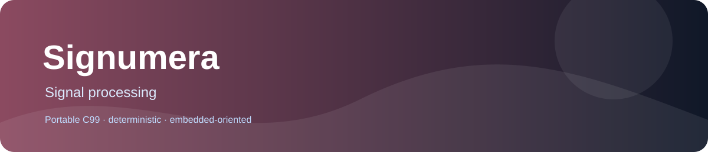

# Signumera
  



Embedded filtering, pulse analysis, windowing and signal measurements.

## Why it exists

Signal firmware needs deterministic sample-by-sample operations with caller-owned state.

## What is included

- Portable C99-oriented implementation.
- Deterministic integer or fixed-point behavior documented at function level.
- No mandatory heap, threads or operating-system services.
- Separate translation units for selective linking.

## Quick start

```sh
cmake -S . -B build -DSIGNUMERA_BUILD_TESTS=ON
cmake --build build --parallel
ctest --test-dir build --output-on-failure
```

For a minimal integration, include only the required public header and compile the matching source unit. The library does not require the rest of PrimitiveCore.

## Documentation

| Need | Read |
|---|---|
| Choose a primitive | [Family guide](docs/FAMILY_GUIDE.md) |
| Check every function and contract | [API reference](docs/API_REFERENCE.md) |
| Reproduce tests and see validation limits | [Testing report](docs/TESTING.md) |
| Review design and dependencies | [Architecture](docs/ARCHITECTURE.md) |
| See measured or pending performance data | [Performance](docs/PERFORMANCE.md) |

## At a glance

The public surface consists of 20 headers and 20 callable API entries under include/. Implementations are in src/ and tests are in tests/. State, buffers and output ownership are explicit in each header contract.

The CMake test option is SIGNUMERA_BUILD_TESTS. The library has no mandatory third-party dependency. Platform-specific link requirements are documented in CMake and the affected API header.

## Validation status

The audit suite includes 19 CTest targets, including a fixed-seed 100,000-iteration independent-reference test for all 20 APIs. GCC, Clang, MSVC Debug/Release, and hosted GCC/Clang AddressSanitizer and UndefinedBehaviorSanitizer jobs passed. A functional ESP32-S3 smoke test invoked all 20 APIs and returned `SIGNUMERA_HW_PASS`. See the [audit register](docs/AUDIT.md) for exact configurations and limits.

Detailed overflow, rounding, invalid-input, memory-ownership and state rules are defined by the public headers and API reference. Do not infer them from the product name alone.

## License

Apache License 2.0, copyright Vanderhell. See [LICENSE](LICENSE) and [NOTICE](NOTICE).

## Origin

A standalone embedded-C library extracted from the PrimitiveCore product catalog. It is independently buildable and linkable.
